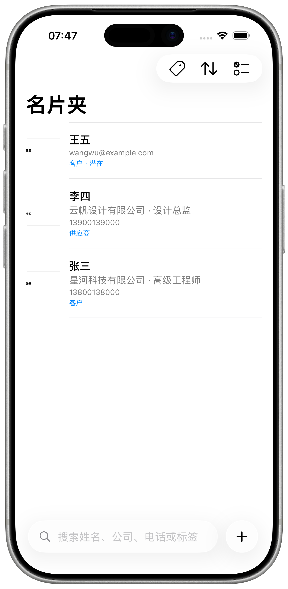
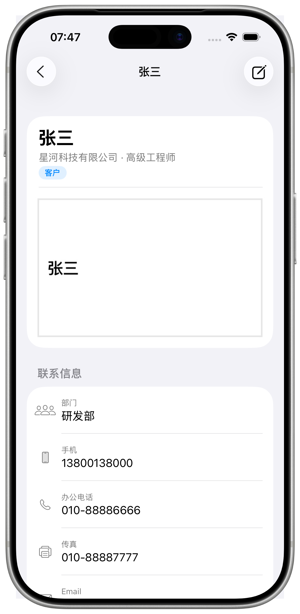
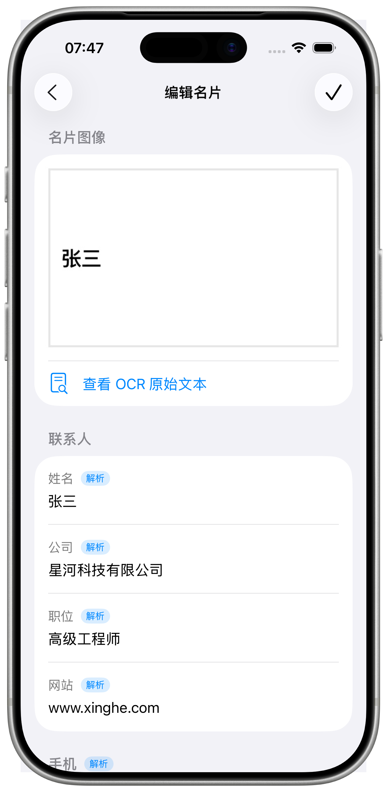
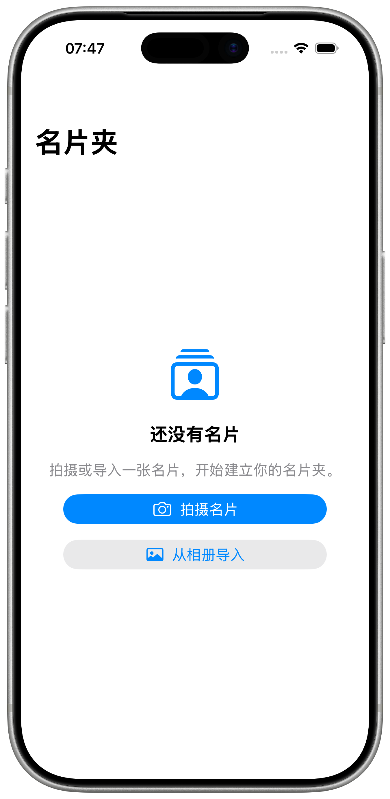

# CamCard

<p align="center">
  
</p>

<p align="center">
  <strong>A local-first business card scanner and contact manager for iOS.</strong><br />
  Capture or import a card, confirm the crop, review the extracted fields, and keep a clean, searchable card holder — all on device.
</p>

<p align="center">
  
  
  
</p>

---

## Overview

CamCard is a small, focused iOS app that turns a paper business card into a structured contact:

1. Take a photo or import one from the photo library.
2. Confirm the card boundary on the crop screen (auto-detected corners are pre-filled).
3. Let on-device OCR and the field parser fill in the details.
4. Correct anything that was misread, add tags or notes, and save.
5. Browse, search, filter, edit, export as vCard, or delete from the card holder.

Everything — images, metadata, OCR text, and corrections — stays in the app's sandbox. There is no account, no cloud, and no network dependency.

## Features

- **Direct system capture** — the camera or photo picker opens immediately; no intermediate capture page.
- **Crop-first flow** — every capture lands on a “框选名片” screen with a draggable quadrilateral, pre-filled by Vision rectangle detection when available.
- **On-device recognition** — Vision OCR plus a rule-based parser for name, company, title, phones (mobile / office / fax), email, website, address, department, postal code, and notes.
- **Manual review** — edit every field, restore parsed values, reclassify phone numbers, and mark what was changed by hand.
- **Single-image storage** — only the corrected image is kept (or the original when correction fails).
- **Fast organization** — floating search bar, tag filters, sort by date/name/company, multi-select, and swipe or long-press actions.
- **vCard export** — export one or many cards as a `.vcf` file through the system share sheet.
- **Local persistence** — atomic JSON store plus image files, verified to survive process termination and relaunch.

## Screenshots

| Card holder | Card detail | Review | Empty state |
| --- | --- | --- | --- |
|  |  |  |  |

The raw simulator captures live in [`docs/assets/screenshots`](docs/assets/screenshots), the device mockup in [`docs/assets/mockups`](docs/assets/mockups), and the framing output in [`docs/assets/framed`](docs/assets/framed).

## Requirements

- Xcode 26 or later
- iOS 26.0 simulator or device
- [XcodeGen](https://github.com/yonaskolb/XcodeGen) 2.46+

## Getting started

```bash
# Generate the Xcode project (CamCard.xcodeproj is not checked in)
xcodegen generate

# Build
xcodebuild -project CamCard.xcodeproj -scheme CamCard \
  -destination 'platform=iOS Simulator,name=iPhone 17 Pro' build
```

Open `CamCard.xcodeproj` in Xcode and run the `CamCard` scheme. SwiftUI previews are available for every screen.

## Architecture

```
CamCard/
├── App/            App entry, environment composition, seed data
├── Models/         BusinessCard, ContactField, capture state, OCR types
├── Repositories/   CardRepository, FileCardRepository, ImageStore
├── Services/       Vision OCR, card detection/rectification, field parser, vCard writer
├── Support/        Image processing, camera permission, clock, preview data
├── ViewModels/     Card holder, capture flow, review, detail, export
└── Views/          Root, card holder, capture flow, review, detail, components
```

- **`AppEnvironment`** wires the concrete services. UI tests swap in in-memory repositories and mock OCR/detection via launch arguments.
- **`BusinessCard`** stores final contact values and image references; **`CardAudit`** keeps the OCR records, parsed fields, and manual corrections for traceability.
- **Views never contain OCR or parsing logic**; they observe `@MainActor` view models.
- **Capture pipeline**: camera/picker → detection → crop confirmation → perspective correction → OCR → parsing → review.

## Testing

```bash
# Unit tests
xcodebuild test -project CamCard.xcodeproj -scheme CamCard \
  -destination 'platform=iOS Simulator,name=iPhone 17 Pro' \
  -only-testing:CamCardTests

# UI tests
xcodebuild test -project CamCard.xcodeproj -scheme CamCard \
  -destination 'platform=iOS Simulator,name=iPhone 17 Pro' \
  -only-testing:CamCardUITests

# Refresh README screenshots
xcodebuild test -project CamCard.xcodeproj -scheme CamCard \
  -destination 'platform=iOS Simulator,name=iPhone 17 Pro' \
  -only-testing:CamCardUITests/ScreenshotCaptureTests \
  -resultBundlePath /tmp/camcard-screens.xcresult
xcrun xcresulttool export attachments \
  --path /tmp/camcard-screens.xcresult --output-path /tmp/camcard-attachments
# Copy the PNGs into docs/assets/screenshots, then:
swift docs/assets/scripts/frame_screenshots.swift
```

The latest verification record is in [`verification/README.md`](verification/README.md).

## Screenshot framing

`docs/assets/scripts/frame_screenshots.swift` places each simulator screenshot into the transparent screen cutout of the iPhone mockup. The screen rect is detected automatically by flood-filling the transparent region from the image centre; pass `--screen x,y,w,h` to override it.

```bash
swift docs/assets/scripts/frame_screenshots.swift \
  --mockup docs/assets/mockups/iphone-17-pro-silver-portrait.png \
  --screenshots docs/assets/screenshots \
  --out docs/assets/framed
```

## Specification-driven development

This repository uses [OpenSpec](https://github.com/Fission-AI/OpenSpec). Capability specs live in [`openspec/specs`](openspec/specs) and are validated with:

```bash
openspec validate --all --strict
```

## Scope

This project implements a ten-feature card slice: card holder, capture/import, detection and correction, OCR, field structuring, manual review, save/detail, search/tags/notes, local persistence, and contact export. It intentionally excludes accounts, subscriptions, ads, cloud sync, team libraries, CRM sync, digital card design, QR exchange, email signatures, and meeting recording.
