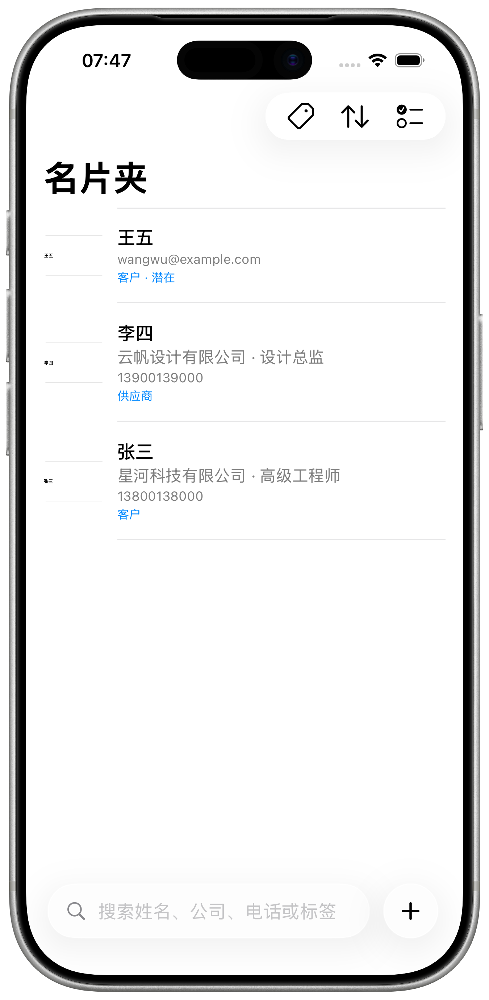
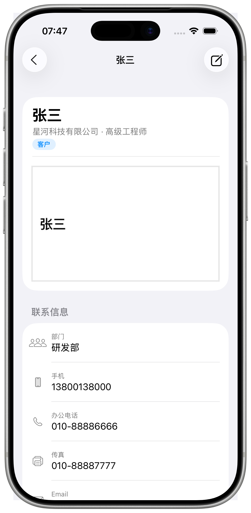
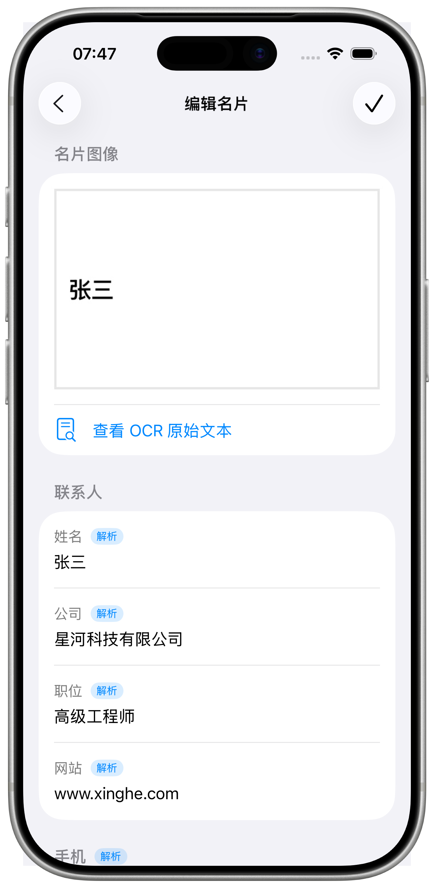
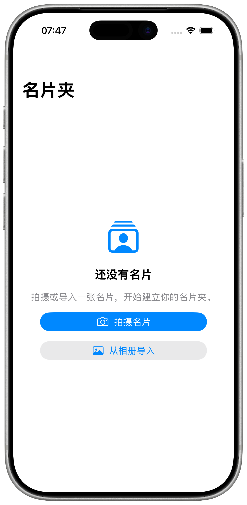

# CamCard

<p align="center">
  
</p>

<p align="center">
  <strong>一款本地优先的 iOS 名片扫描与联系人管理应用。</strong><br />
  拍摄或导入名片、确认框选、核对识别结果，并维护一个干净、可搜索的名片夹——全部在设备本地完成。
</p>

<p align="center">
  
  
  
</p>

---

## 简介

CamCard 是一款小而专注的 iOS 应用，把一张纸质名片变成结构化联系人：

1. 用相机拍摄，或从相册导入一张名片图片。
2. 在「框选名片」页确认名片边界（自动检测成功时会预先填好四角）。
3. 由端侧 OCR 与字段解析器自动填写各项信息。
4. 修正识别错误、添加标签或备注并保存。
5. 在名片夹中浏览、搜索、筛选、编辑、导出 vCard 或删除。

图像、元数据、OCR 文本与人工修正全部保存在应用沙盒内，没有账号、没有云端、也不依赖网络。

## 功能

- **直接唤起系统界面**——相机或相册选择器立即弹出，不再经过独立的拍摄/导入页。
- **框选优先的流程**——每次采集都先进入「框选名片」页，提供可拖动的四边形；Vision 检测成功时自动预填四角。
- **端侧识别**——Vision OCR 与规则解析器提取姓名、公司、职位、电话（手机/办公/传真）、邮箱、网站、地址、部门、邮编与备注。
- **人工校正**——逐字段编辑、恢复解析原值、调整电话类别，并记录哪些字段被人工修改。
- **单图存储**——只保留校正后的图像；校正失败时保留原图。
- **高效管理**——底部悬浮搜索栏、标签筛选、按时间/姓名/公司排序、多选，以及左滑与长按操作。
- **vCard 导出**——通过系统分享面板导出一张或多张名片的 `.vcf` 文件。
- **本地持久化**——原子写入的 JSON 索引加独立图像文件，已验证进程终止与重启后数据一致。

## 截图

| 名片夹 | 名片详情 | 校正页 | 空状态 |
| --- | --- | --- | --- |
|  |  |  |  |

模拟器原始截图位于 [`docs/assets/screenshots`](docs/assets/screenshots)，设备样机位于 [`docs/assets/mockups`](docs/assets/mockups)，套好样机的成品位于 [`docs/assets/framed`](docs/assets/framed)。

## 环境要求

- Xcode 26 或更高版本
- iOS 26.0 模拟器或真机
- [XcodeGen](https://github.com/yonaskolb/XcodeGen) 2.46+

## 快速开始

```bash
# 生成 Xcode 工程（CamCard.xcodeproj 不纳入版本控制）
xcodegen generate

# 构建
xcodebuild -project CamCard.xcodeproj -scheme CamCard \
  -destination 'platform=iOS Simulator,name=iPhone 17 Pro' build
```

用 Xcode 打开 `CamCard.xcodeproj`，运行 `CamCard` scheme 即可。每个界面都提供了 SwiftUI `#Preview`。

## 架构

```
CamCard/
├── App/            应用入口、环境组装、种子数据
├── Models/         BusinessCard、ContactField、采集状态、OCR 类型
├── Repositories/   CardRepository、FileCardRepository、ImageStore
├── Services/       Vision OCR、名片检测与透视校正、字段解析、vCard 导出
├── Support/        图像处理、相机权限、时钟、预览数据
├── ViewModels/     名片夹、采集流程、校正、详情、导出
└── Views/          Root、名片夹、采集流程、校正、详情、通用组件
```

- **`AppEnvironment`** 统一组装具体服务；UI 测试通过启动参数替换为内存仓库与 Mock OCR/检测服务。
- **`BusinessCard`** 保存最终联系人字段与图像引用；**`CardAudit`** 保留 OCR 记录、解析字段与人工修正，便于追溯。
- **View 不包含 OCR 或解析逻辑**，只观察 `@MainActor` ViewModel。
- **采集链路**：相机/相册 → 检测 → 框选确认 → 透视校正 → OCR → 字段解析 → 校正页。

## 测试

```bash
# 单元测试
xcodebuild test -project CamCard.xcodeproj -scheme CamCard \
  -destination 'platform=iOS Simulator,name=iPhone 17 Pro' \
  -only-testing:CamCardTests

# UI 测试
xcodebuild test -project CamCard.xcodeproj -scheme CamCard \
  -destination 'platform=iOS Simulator,name=iPhone 17 Pro' \
  -only-testing:CamCardUITests

# 重新生成 README 截图
xcodebuild test -project CamCard.xcodeproj -scheme CamCard \
  -destination 'platform=iOS Simulator,name=iPhone 17 Pro' \
  -only-testing:CamCardUITests/ScreenshotCaptureTests \
  -resultBundlePath /tmp/camcard-screens.xcresult
xcrun xcresulttool export attachments \
  --path /tmp/camcard-screens.xcresult --output-path /tmp/camcard-attachments
# 将 PNG 复制到 docs/assets/screenshots 后执行：
swift docs/assets/scripts/frame_screenshots.swift
```

最新验证记录见 [`verification/README.md`](verification/README.md)。

## 截图套样机

`docs/assets/scripts/frame_screenshots.swift` 会把每张模拟器截图放入 iPhone 样机的透明屏幕区域。屏幕矩形通过从图片中心对透明区域做洪泛填充自动检测，也可以用 `--screen x,y,w,h` 手动指定。

```bash
swift docs/assets/scripts/frame_screenshots.swift \
  --mockup docs/assets/mockups/iphone-17-pro-silver-portrait.png \
  --screenshots docs/assets/screenshots \
  --out docs/assets/framed
```

## 规格驱动开发

本仓库使用 [OpenSpec](https://github.com/Fission-AI/OpenSpec)。能力规格位于 [`openspec/specs`](openspec/specs)，可通过以下命令校验：

```bash
openspec validate --all --strict
```

## 范围

项目只实现名片切片的十项核心能力：名片夹、拍摄与导入、区域检测与校正、OCR、字段结构化、人工校正、保存与详情、搜索与标签备注、本地持久化、联系人导出。不包含账号、订阅、广告、云同步、团队库、CRM 同步、数字名片设计、二维码交换、邮件签名与会议录音。
